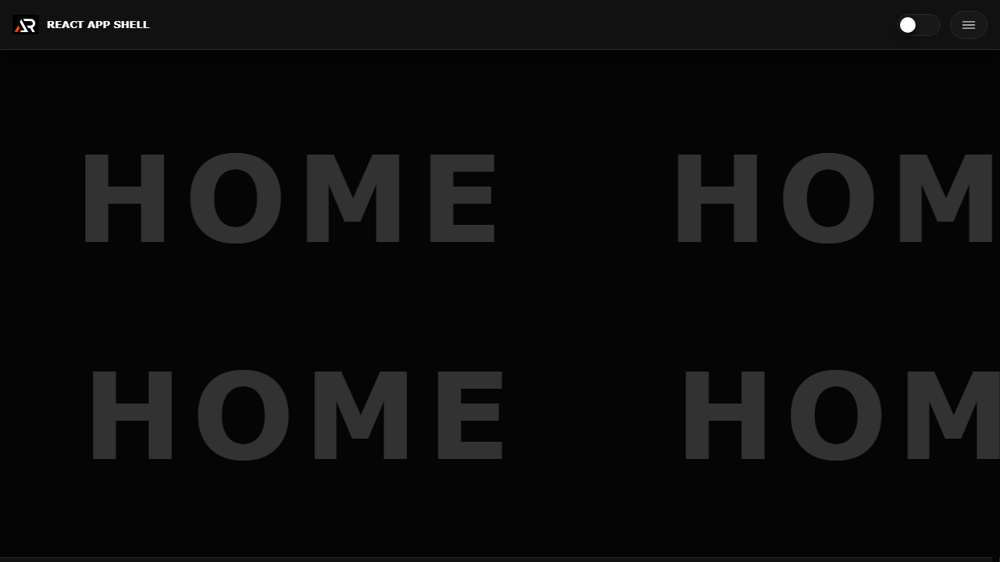

# React App Shell

A reusable React and Vite starter for small multi-page apps. It includes lazy-loaded routes, a searchable navigation drawer, persistent dark and light themes, and responsive layout components. The routes currently render placeholder scrolling panels that you can replace with app pages.



## Features

- Lazy-loaded React Router routes with a loading state
- Searchable, collapsible navigation groups
- Dark and light themes with local preference persistence
- Responsive drawer navigation and reusable layout primitives
- GitHub Pages deployment with a route fallback

## Stack

React 18, Vite, React Router, Material UI, styled-components, and React Icons.

## Run locally

Requires Node.js and npm.

```sh
npm install
npm run dev
```

Create and preview a production build with `npm run build` and `npm run preview`. Publish to the configured GitHub Pages site with `npm run deploy`.

## Links

- Live app: [a2rp.github.io/react-app-shell](https://a2rp.github.io/react-app-shell/)
- Repository: [github.com/a2rp/react-app-shell](https://github.com/a2rp/react-app-shell)
- Portfolio: [ashishranjan.net](https://www.ashishranjan.net/)
